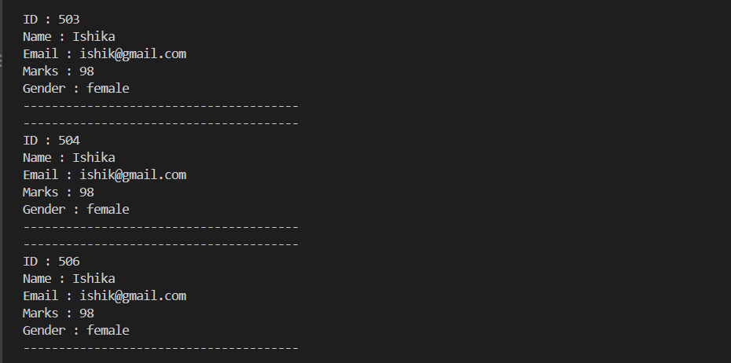

# Student CRUD – JDBC Demo

A learning project that connects a plain Java application to a PostgreSQL database using **JDBC**. It implements the four fundamental database operations (**Create, Read, Update, Delete**) on a `student` table, with no frameworks involved. The aim of the build is to understand what actually happens between Java code and a relational database before moving on to tools like Hibernate or Spring Data.

---

## Overview

The application manages student records. Each student has an id, name, email, marks and gender. Through a small data-access layer, the program can add a new student, list all students, change a student's marks, and remove a student from the database.

The project is deliberately small so that each JDBC concept stays visible: opening a connection, sending SQL, reading results, and closing resources.

---

## What This Project Demonstrates

- Connecting Java to PostgreSQL with the **JDBC API** and `DriverManager`
- Running **INSERT, SELECT, UPDATE and DELETE** statements from Java
- The difference between `executeUpdate()` (changes data, returns affected row count) and `executeQuery()` (returns a `ResultSet`)
- Reading rows from a `ResultSet` column by column
- Automatic resource cleanup with **try-with-resources**
- Separating concerns using the **POJO** and **DAO** patterns
- Managing the JDBC driver dependency with **Maven**

---

## Tech Stack

| Area       | Choice                                       |
| ---------- | -------------------------------------------- |
| Language   | Java (compiler level set to 25 in `pom.xml`) |
| Build tool | Maven                                        |
| Database   | PostgreSQL                                   |
| Driver     | `org.postgresql:postgresql` 42.7.13          |
| Testing    | JUnit 4.11 (default placeholder test)        |

---

## Prerequisites

The following need to be available for the project to build and run:

| Requirement              | Details                                                                                                                                                                 |
| ------------------------ | ----------------------------------------------------------------------------------------------------------------------------------------------------------------------- |
| **JDK**                  | A version matching the compiler level in `pom.xml` (currently 25). The `maven.compiler.source` and `maven.compiler.target` values can be lowered to match an older JDK. |
| **Apache Maven**         | Used to compile the project and download the PostgreSQL driver.                                                                                                         |
| **PostgreSQL**           | A running local server on the default port `5432`.                                                                                                                      |
| **Database and table**   | A database named `student_db` containing the `student` table described in the [Database](#database) section.                                                            |
| **Environment variable** | `DB_PASSWORD` set to the PostgreSQL password (see [Configuration](#configuration)).                                                                                     |
| **IDE (optional)**       | VS Code, IntelliJ or Eclipse for running `mainApp`.                                                                                                                     |

---

## Configuration

Database credentials are not stored in the source code. The password is read from an **environment variable** at runtime, so no secret is committed to the repository.

| Setting  | Source                                                                 |
| -------- | ---------------------------------------------------------------------- |
| URL      | `jdbc:postgresql://localhost:5432/student_db` (in `connectionDB.java`) |
| Username | `postgres` (in `connectionDB.java`)                                    |
| Password | Environment variable `DB_PASSWORD`                                     |

Reading the password this way keeps the code safe to publish on GitHub and lets each machine use its own credentials.

---

## Project Structure

```
student-crud-jdbc-demo/
├── pom.xml
├── screenshots/
│   └── output.png           # Screenshot of the program output
└── src/
    ├── main/java/school/
    │   ├── connectionDB.java    # Opens the database connection
    │   ├── studentPOJO.java     # Student data model
    │   ├── studentDAO.java      # CRUD operations
    │   └── mainApp.java         # Entry point / demo
    └── test/java/com/ishika/
        └── AppTest.java         # Default Maven test
```

---

## Design

The code is split into small layers, each with one job:

```
mainApp  ──►  studentDAO  ──►  connectionDB  ──►  PostgreSQL (student_db)
                  ▲
          studentPOJO (data passed between layers)
```

| Class          | Role                                                                                                                                         |
| -------------- | -------------------------------------------------------------------------------------------------------------------------------------------- |
| `mainApp`      | Entry point. Creates a student object and calls the DAO methods in sequence.                                                                 |
| `studentPOJO`  | A plain Java object that holds one student's data (id, name, email, marks, gender) with a constructor and getters. It has no database logic. |
| `studentDAO`   | The Data Access Object. All SQL lives here, one method per operation.                                                                        |
| `connectionDB` | A small utility that returns a `Connection` using the URL, username and password.                                                            |

Keeping SQL inside the DAO means the rest of the program never needs to know how the data is stored.

---

## Database

The program works against a PostgreSQL database named `student_db` containing a single `student` table:

| Column   | Type (intended)       | Notes                          |
| -------- | --------------------- | ------------------------------ |
| `id`     | `SERIAL`, primary key | Auto-generated by the database |
| `name`   | `VARCHAR`             | Student name                   |
| `email`  | `VARCHAR`             | Student email                  |
| `marks`  | `INT`                 | Marks scored                   |
| `gender` | `VARCHAR`             | Gender                         |

Because `id` is generated by the database, the Java code never supplies it when inserting a student.

The connection uses the standard local PostgreSQL address (`localhost:5432`) with the `postgres` user; the password comes from an environment variable.

---

## How Each Operation Works

### Create – `addStudent(studentPOJO s)`

Takes a `studentPOJO`, builds an `INSERT INTO student (name, email, marks, gender) ...` statement from its getters, and runs it with `executeUpdate()`. If at least one row is affected, it prints _"Student added successfully"_.

### Read – `getAllStudnets()`

Runs `SELECT * FROM student` with `executeQuery()`. The returned `ResultSet` is walked with `rs.next()`, and each row's columns are read with `getInt` / `getString` and printed in a formatted block.

### Update – `updateStudentMark(int newMark, int id)`

Runs `UPDATE student SET marks = ... WHERE id = ...`. The `WHERE` clause restricts the change to one student. A confirmation message prints when a row was updated.

### Delete – `deleteStudent(int id)`

Runs `DELETE FROM student WHERE id = ...` and confirms when a row was removed. In the demo, this call is commented out in `mainApp` to protect existing data.

### Connection handling – `connectionDB.getConnection()`

Calls `DriverManager.getConnection(url, username, password)`, where the password is read from the `DB_PASSWORD` environment variable. Each DAO method opens its connection inside a **try-with-resources** block, so the connection is closed automatically even when an exception occurs.

---

## The Demo Run

`mainApp` exercises the DAO in this order:

```java
studentDAO dao = new studentDAO();
studentPOJO s1 = new studentPOJO("Ishika", "ishik@gmail.com", 98, "female");

dao.addStudent(s1);            // Create
dao.updateStudentMark(90, 2);  // Update the student with id 2
dao.getAllStudnets();          // Read
// dao.deleteStudent(505);     // Delete (disabled)
```

### Output



_Console output of `mainApp` showing the add, update and read operations._

---

## Current Limitations

Since this is a learning build, a few things are intentionally basic. They are noted here because understanding them is part of the learning.

- **SQL is built by string concatenation.** Values are joined directly into the query text, which makes the code open to SQL injection. `PreparedStatement` with `?` placeholders is the correct approach and is the main planned improvement.
- **Only the password is externalised.** The URL and username are still constants in `connectionDB.java`; they could also move to environment variables or a config file.
- **Connection errors lose their detail.** `connectionDB` throws a `RuntimeException` without a message or the original cause, so different failures look identical.
- **A new connection is opened per operation.** A connection pool (such as HikariCP) would be used in a real application.
- **The read method only prints.** Returning a `List<studentPOJO>` would make it reusable and testable.
- **Demo values are fixed.** The update targets id `2`, which assumes that row exists.
- **Naming.** Class names are lowercase (`studentDAO`, `mainApp`) instead of Java's `PascalCase`, and `getAllStudnets` contains a typo.
- **Tests.** `AppTest.java` is the default Maven placeholder; no real tests exist yet.

---

## Planned Improvements

- Convert all DAO methods to `PreparedStatement`
- Move the database URL and username to environment variables as well
- Return `List<StudentPOJO>` from the read method and add lookup by id
- Add a console menu so operations can be chosen interactively
- Add input validation (e.g. marks between 0 and 100)
- Add a `.gitignore` for `target/` and local config
- Write JUnit tests against a test database
- Explore transactions (`commit` / `rollback`) and connection pooling

---

## Author

**Ishika**
Repository: [github.com/ishika9859/student-crud-jdbc-demo](https://github.com/ishika9859/student-crud-jdbc-demo)
